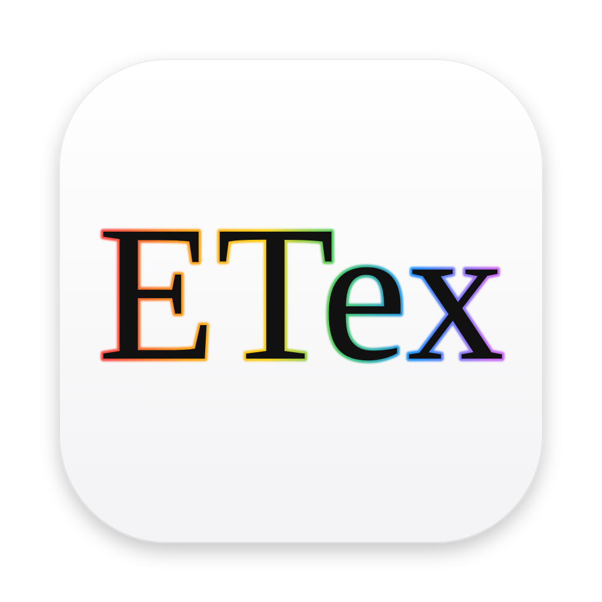

<p align="center">
  
</p>

<h1 align="center">EasyTeX</h1>

<p align="center">
  <b>Simple and easy to install LaTeX editor for Mac with everything already included</b><br><br>
  In the spirit of Overleaf: files on the left, editor in the middle, live PDF on the right.<br>
  Press <b>⌘S</b> to save and compile.<br>
  <sub>Apple Silicon · macOS 14 or newer</sub>
</p>

## tl;dr

| | **EasyTeX** | **EasyTeX PLUS** |
|---|---|---|
| Download | ~3 MB | ~1.8 GB |
| TeX included | No: uses MacTeX, BasicTeX or TinyTeX, or installs TinyTeX once | Yes: TeX Live, ready to go |
| Internet needed | Once, if you have no TeX yet | Never |
| Missing packages | Offers to install them | Everything is included except Chinese, Japanese and Korean support |

1. **Install:** open the `.dmg` and drag the app to **Applications**.
2. **First launch:** the app isn't signed by Apple yet, so macOS blocks it once. Go to **System Settings → Privacy & Security**, click **Open Anyway** and confirm.
3. **Write:** pick a folder, open a `.tex` file, press **⌘S**.
4. **Uninstall:** run **Uninstall EasyTeX** from the `.dmg`. It moves the app and its settings to the Trash. Your documents are never touched.

## Handy keys

| Keys | What it does |
|---|---|
| ⌘S | Save and compile |
| ⌘J | Jump from the cursor to the PDF (double-click the PDF to jump back) |
| ⌘/ | Comment or uncomment lines |
| ⌘B | Show or hide the file list |
| ⇧⌘P | Show or hide the PDF |
| ⇧⌘L | Problems and log |

Which file gets compiled: the one named in a `% !TEX root = main.tex` line, otherwise the open file if it has `\documentclass`, otherwise a `main.tex` nearby. For XeLaTeX or LuaLaTeX, put `% !TEX program = xelatex` (or `lualatex`) at the top. Build files go into a hidden `.build` folder next to your document.

## Try it

The `sample` folder has a small document (`main.tex`), one with an error (`broken.tex`) and `feature-test.tex`, which walks through every feature section by section.

## Build it yourself

```bash
scripts/build-app.sh          # build/EasyTeX.app
scripts/build-app.sh PLUS     # build/EasyTeX PLUS.app (downloads TeX Live first, once, ~5 GB)
scripts/make-dmg.sh           # build/EasyTeX.dmg
scripts/make-dmg.sh PLUS      # build/EasyTeX-PLUS.dmg
```

Or open `Package.swift` in Xcode and press Run. On GitHub, **Actions → Build EasyTeX → Run workflow** builds both `.dmg` files; pushing a tag like `v0.1.0` also attaches them to a release.

## Inside

- `Sources/EasyTeX`: the SwiftUI app (window, file list, tabs, PDF, compiling, first-run TeX setup)
- `Resources/editor`: the Monaco editor (the editor of VS Code) and `easytex.js`, which adds LaTeX support
- `scripts`: building the apps, the TeX Live for PLUS, the uninstaller and the disk images

## License

EasyTeX is MIT licensed (`LICENSE`). It includes the Monaco editor, also MIT (`Resources/editor/MONACO-LICENSE.txt`). TeX Live, bundled in PLUS, consists of free software under various licenses.
